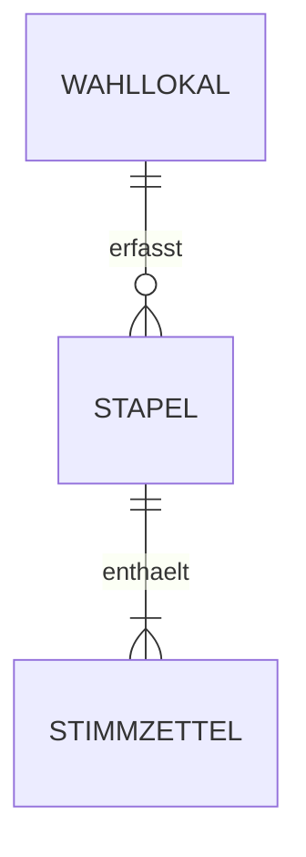

# Datenmodell des Wahlassistenten

Jede Wahl erhält ein eigenes MariaDB-Schema, also eine eigene Datenbank mit demselben
Tabellenaufbau. Wahllokale, Stapel und Ergebnisse verschiedener Wahlen bleiben dadurch getrennt.
Es gibt keine zusätzliche Wahl-Tabelle und keine Wahl-ID in jeder Ergebniszeile.

## Vier fachliche Tabellen

| Tabelle | Inhalt |
|---|---|
| `wahllokal` | Nummer (Primärschlüssel, z. B. `518`), Name und erwartete Stimmzettelzahl. |
| `stapel` | Kennung, Wahllokalnummer, Sollzahl, Eingangszeit und Prüfsumme für Wiederholungsuploads. |
| `wahlvorschlag` | Stimmenart, eindeutige Kennung, gedruckter Listenplatz und Partei-/Kandidatenbeschriftung. |
| `stimmzettel` | Erfassungskennung, Stapel, optionale QR-Kennung, fachliches Ergebnis als JSON und Hash/Dateityp des Belegs. |

Dazu kommen drei technische Tabellen für die Anmeldung: `app_user` (Konto mit Rolle `admin` oder
`wahlvorstand`, ein Wahlvorstand mit seinem Wahllokal), `app_session` (Sitzungstoken, nur als
SHA-256) und `app_login_attempt` (Fehlversuche für die Drosselung). `stapel.erfasst_von` verweist
auf das Konto, das den Stapel übertragen hat. Die Konten gehören zur Datenbank der Wahl und werden
für jede Wahl neu angelegt.



Ein Stimmzettelergebnis steht zusammenhängend in `stimmzettel.ergebnis`:

```json
{
  "erststimme": { "status": "gueltig", "wahlvorschlaege": ["E1"] },
  "zweitstimme": { "status": "zweifelsfall", "wahlvorschlaege": [] }
}
```

Ein Europawahlzettel enthält nur `stimme`. Mehrere angekreuzte Wahlvorschläge können in einer
Stimme gespeichert werden, auch bei einer Mehrfachmarkierung. Die Statuswerte sind `gueltig`,
`leer`, `mehrfach` und `zweifelsfall`.

Der Server prüft vor der Speicherung, ob jede Stimmenart vorhanden ist, alle angegebenen
Wahlvorschläge zu dieser Stimme gehören und die Markierungsanzahl zum Status passt. Diese
Zuordnung im JSON übernimmt die Anwendung, nicht ein Datenbank-Fremdschlüssel. Die DB prüft
gültiges JSON, Stapel-/Wahllokalzuordnung und eindeutige Erfassungs- und QR-Kennungen.

Wahlvorschläge werden aus den fachlichen Angaben der Konfiguration übernommen. Die gedruckte
Nummer ist unabhängig von der internen Kennung; Listenplätze dürfen Lücken enthalten.
Kandidaten- und Parteinamen bleiben als gedruckte Beschriftung erhalten und werden nicht geraten
oder automatisch zerlegt. Koordinaten, Radien, Füllgrade und Kalibrierungsdateien werden
weder als Ergebnis übertragen noch in der DB gespeichert.

Zu jedem Zettel wird ein Beleg gespeichert: die Aufnahme, auf 1600 Pixel Breite verkleinert, als
JPEG (Qualität 85). Der Browser erzeugt dieses Bild direkt nach der Aufnahme und erkennt genau
dieses Bild, nicht das Kamera-Original. Damit reproduziert der Beleg die Wertung, und ein Handyfoto
schrumpft von rund 3 MB auf rund 0,5 MB. An allen 53 echten Fotos geprüft: Selbst bei Qualität 30
ändert sich keine Wertung; die Fototests erkennen genau dieses Beleg-JPEG. Die Belege liegen im Belegordner der PHP-API (`bilder_path`, Standard `php-api/bilder/`); die DB enthält ihren SHA-256-Hash
und Dateityp. Der Hash bestimmt den Dateinamen, verbindet Aufnahme und Ergebnis und wird beim
Abruf geprüft. Bilder sind ausschließlich über die authentifizierte Server-API zugänglich.
Das Control-Center zeigt pro Stapel die einzelnen Zettel mit Ergebnis und Beleg.
Bei PDF-Eingaben wird die erste Seite erkannt und als Beleg-JPEG gespeichert. Ältere Belege aus der
Zeit vor der Verkleinerung (PNG, Original-JPEG, PDF) bleiben gültig und abrufbar.

Auf dem Client bleiben Ergebnisse und Belege in IndexedDB erhalten, bis der Server
die Übernahme des vollständigen Stapels bestätigt. Der Server legt die Dateien vor dem DB-Commit
ab. Ein abgebrochener DB-Schreibvorgang kann unreferenzierte Dateien hinterlassen, aber keine
gezählten Ergebnisse ohne zuvor gespeicherten Beleg. Identische Dateien werden physisch nur einmal
gespeichert; jeder Zettel hat trotzdem seine eigene Zuordnung. Das ersetzt keine QR-Doppelprüfung.

Stapel und alle Zettel werden gemeinsam in einer Transaktion gespeichert. Dieselbe
Stapelkennung mit denselben Ergebnissen zählt nicht erneut. Die Prüfsumme bezieht sich nur
auf die Ergebnisse, Zuordnungen und den Hash/Dateityp des Belegs. Die Ergebnisübersicht summiert die JSON-Einzelergebnisse
je Partei/Kandidat, Stimme, Stapel und Wahllokal. Es gibt keine separaten Tabellen oder Views
für Stimmenwertungen, Markierungen oder Summen.

Die Stimmenarten, deren Namen und Auswahlregeln sowie die Wahlbezeichnung stehen in der
Konfiguration. Eine reine Änderung der Erkennungskoordinaten verändert die fachliche Wahl nicht.
Welche Datenbank gilt, steht in `php-api/config.local.php`. Die API legt die Tabellen beim ersten
Zugriff an und trägt die Wahlvorschläge ein; enthält die Datenbank andere, verweigert sie den Betrieb.
Der Betreiber verwendet für jede neue Wahl eine neue, leere Datenbank, auch wenn dieselben
Wahlvorschläge erneut antreten.

`gueltig` bezeichnet weiterhin das lokale Erkennungsergebnis, keinen abschließenden Beschluss
des Wahlvorstands. QR-Erkennung und Entscheidungen über Zweifelsfälle sind noch nicht implementiert.
Ohne gelesene QR-Kennung ist die Erfassungskennung eine Aufnahme-ID und kann eine erneute Fotografie
desselben Papierzettels nicht erkennen.

Das ausführbare Schema steht in [server/schema.sql](../server/schema.sql).
